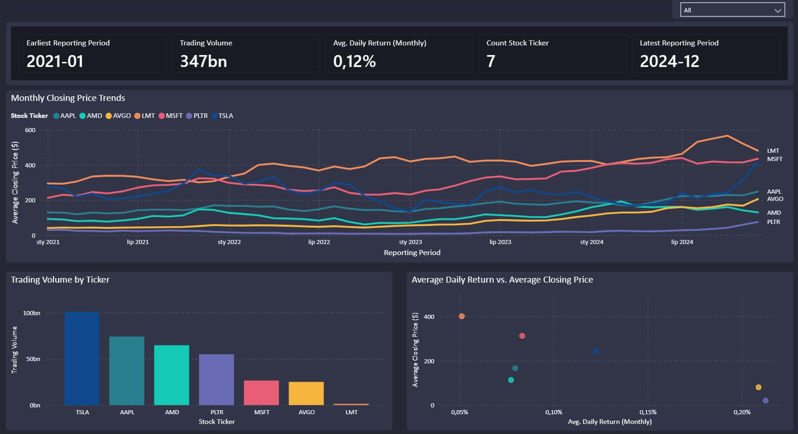

# Stock Market Insights (2021–2024)

An end-to-end analytics engineering portfolio project analyzing daily prices for seven US-listed companies from January 2021 through December 2024: TSLA, AAPL, MSFT, PLTR, AMD, LMT, and AVGO.

The repository includes the Python extraction pipeline, dbt models, a sample combined CSV, and a Power BI dashboard screenshot. Azure Blob Storage and Snowflake are the intended cloud services. Running those cloud steps requires active Azure and Snowflake accounts; the repository does not include credentials or a live hosted pipeline.

## Architecture

```text
yfinance → Python ETL → all_stocks.csv → Azure Blob Storage → Snowflake RAW.STOCK_PRICES → dbt → Power BI
```

| Layer | Tool | Purpose |
|---|---|---|
| Extraction | Python, yfinance, pandas | Download adjusted daily OHLCV prices and derive return and moving-average columns |
| Local handoff | `data/all_stocks.csv` | One canonical CSV containing all tickers |
| Object storage | Azure Blob Storage | Store the canonical CSV in the `raw-data` container |
| Warehouse | Snowflake | Load the CSV into `STOCK_MARKET.RAW.STOCK_PRICES` |
| Transformation | dbt Core, dbt-snowflake | Deduplicate identical rows, validate the daily grain, and build monthly aggregates |
| Visualization | Power BI | Explore price, volume, and return metrics; screenshot in `Images/` |

## Repository layout

```text
etl/                         Extraction and Azure upload scripts
data/all_stocks.csv          Combined sample dataset (one row per ticker/date)
stock_market/                dbt project
Images/dashboard.png         Dashboard screenshot
```

## Data and metrics

- The checked-in sample contains 7,035 rows: 1,005 trading days for each of seven tickers, dated 2021-01-04 through 2024-12-31.
- `daily_return` is a fraction, not a number multiplied by 100. For example, `0.002` means `0.2%`. Format it as a percentage in Power BI.
- The first daily return and first six 7-day moving averages for each ticker are null by design.
- The mart grain is one row per ticker and calendar month. It contains average/minimum/maximum adjusted close, average daily return, average 7-day moving average, and total shares traded.
- Average daily return is an arithmetic mean, not a risk-adjusted performance measure. Volume counts shares, not traded dollar value.

The dashboard screenshot shows the checked-in sample. It is not a live connection, and the original Power BI report file is not included.

## Run locally

Python 3.10 or newer is recommended. Install the extraction dependencies:

```bash
python -m pip install yfinance pandas
```

Generate the combined CSV:

```bash
python etl/extract_stock_data.py
```

This replaces `data/all_stocks.csv`. The date range is fixed to 2021-01-01 through 2024-12-31; yfinance's end date is exclusive. The current yfinance response can change over time, so regenerated adjusted-price values may differ slightly from the checked-in snapshot.

## Optional Azure and Snowflake steps

These steps need valid credentials and provisioned services. No credentials are stored in this repository.

1. Create an Azure Blob container named `raw-data`.
2. Put `AZURE_CONNECTION_STRING` in a root-level `.env` file. Keep `.env` private; it is ignored by Git.
3. Upload only the canonical file:

   ```bash
   python -m pip install azure-storage-blob python-dotenv
   python etl/upload_to_blob.py
   ```

4. In Snowflake, configure an external stage and CSV file format for that container, then load `all_stocks.csv` into `STOCK_MARKET.RAW.STOCK_PRICES`. The target table should have the CSV columns in the same order: `DATE, CLOSE, HIGH, LOW, OPEN, VOLUME, TICKER, DAILY_RETURN, MOVING_AVG_7D, YEAR, MONTH`. Load only `all_stocks.csv`; do not load per-ticker copies alongside it.

   For a deliberate full refresh of this dedicated RAW table, clear it before reloading and force Snowflake to read the file again (otherwise Snowflake's load history can skip a file it has already seen):

   ```sql
   TRUNCATE TABLE STOCK_MARKET.RAW.STOCK_PRICES;

   COPY INTO STOCK_MARKET.RAW.STOCK_PRICES
   FROM @<your_external_stage>/all_stocks.csv
   FILE_FORMAT = (TYPE = CSV SKIP_HEADER = 1)
   FORCE = TRUE
   ON_ERROR = 'ABORT_STATEMENT';
   ```

   Replace `<your_external_stage>` with the stage name you configured. `TRUNCATE` removes the existing table rows, so use this only when a full replacement is intended.

5. Install dbt and the Snowflake adapter, create a local `~/.dbt/profiles.yml` for the `stock_market` profile, then run:

   ```bash
   python -m pip install dbt-snowflake
   cd stock_market
   dbt deps
   dbt run
   dbt test
   ```

   The dbt source is configured as database `STOCK_MARKET`, schema `RAW`, table `STOCK_PRICES`. The profile and Snowflake account are not included, so cloud execution cannot be reproduced without configuring them.

## Dashboard and findings



The sample shows AVGO and PLTR with the highest arithmetic mean daily returns (about 0.21% and 0.207% per trading day), and LMT with the lowest (about 0.053%). These figures do not account for volatility, dividends, or risk. The dashboard's volume ranking is based on shares traded, which favors lower-priced stocks; traded value (`close × volume`) would support a fairer comparison.

## Known limitations

- Cloud loading and dbt execution require user-provisioned Azure and Snowflake resources; they have not been presented as a currently hosted service.
- The pipeline refreshes the complete fixed date range; there is no incremental loading or orchestration.
- The dashboard source file is not included, only its screenshot.
- The return comparison does not include volatility, Sharpe ratio, dividends, or other risk measures.
